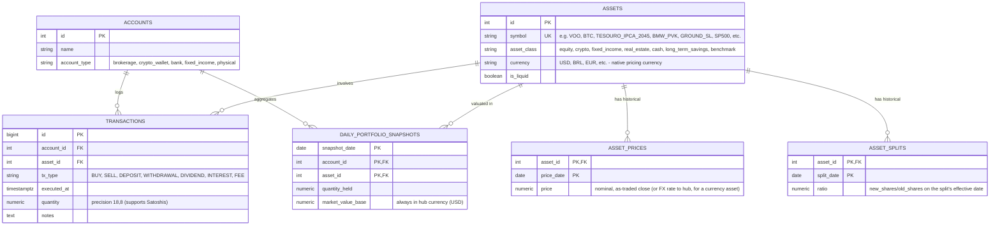
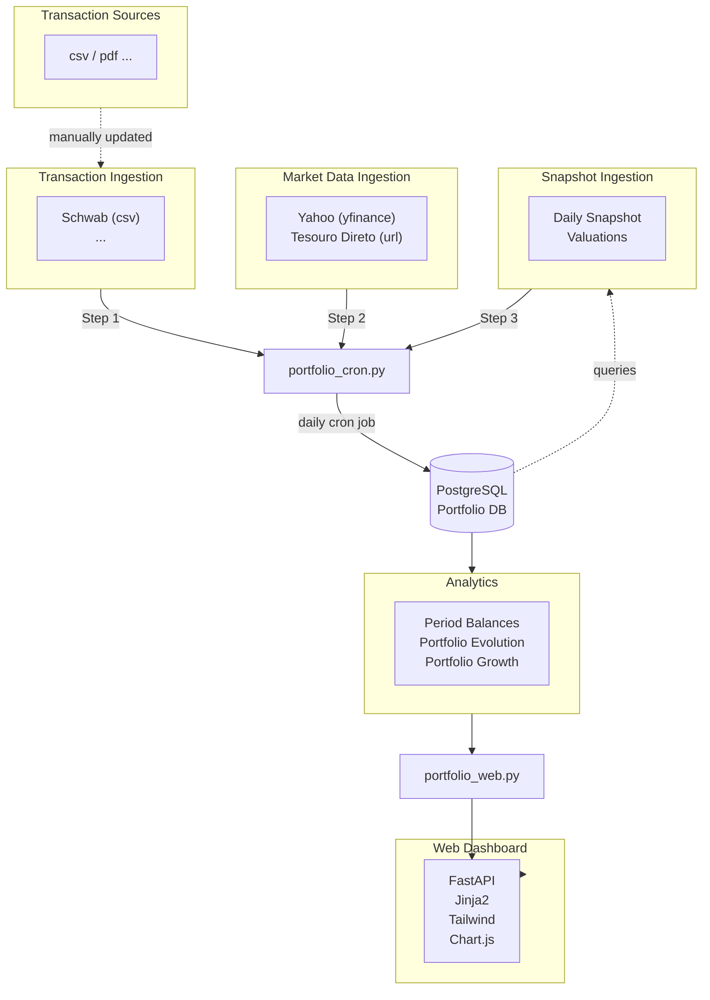

# Personal Financial Portfolio Analyzer

A personal portfolio tracker: transactions from several brokers/banks/institutions
and in different formats get ingested into a Postgres database, valued daily in a fixed
hub currency, and reported through a small FastAPI + Jinja2 + Tailwind web dashboard
(no build step, no JS framework - everything server-rendered with Chart.js for graphs).

## Data Model

* **Accounts**: Catalogs where assets live (e.g. broker, bank, institution, etc.).

* **Assets**: Catalogs the assets and what they are (equity, crypto, fixed income, real estate, fiat, long-term savings, benchmark).

* **Transactions** (The Source of Truth Ledger): A pure transaction ledger - records every buy,
  sell, deposit, withdrawal, yield, dividend, and fee. No price/amount/currency is stored on the transaction itself - every dollar figure (cash flows, XIRR, Net Invested, display) is derived
  at read time from `quantity x asset_prices.price x FX`, the same canonical series used for valuation everywhere else, so nothing else in this app is ever hand-edited and every derived
  number is recomputed from this ledger plus that one price series.

* **Asset Prices**: Daily price quotes against a fixed hub currency (`HUB_CURRENCY = "USD"`) - any two currencies convert via one extra hop (`native -> hub -> display`) instead of needing a stored rate for every pair. A currency is just another `cash`-class asset (symbol == currency code, e.g. `EUR`/`BRL`) whose own price history *is* its FX rate against the hub - no separate FX table needed. `price` is always the nominal, as-actually-traded value for that date - never split-adjusted (see Asset Splits below).

* **Asset Splits**: Corporate-action events for equities (effective date + `new_shares/old_shares` ratio). Kept separate from Asset Prices rather than a per-row column, since a split is a rare event, not a daily fact. Consumers reconstruct whatever basis they need at read time: `ingest/snapshot.py` forward-adjusts a transaction's raw quantity by the cumulative ratio of every split after it, while `analytics/utils.py`'s `get_daily_price_series` reverses the same factor onto price for continuous, non-jumpy benchmark/growth charts - the adjusted value is never persisted, only ever derived on the fly from the nominal price + this table.

* **Daily Portfolio Snapshots**: One valuation snapshot per calendar day, derived from Holdings × that day's known Price × that day's known FX rate (never today's data misapplied to a past date).



A `benchmark`-class asset (see Market Data Service below) is a special case: it's a normal row
in `assets`/`asset_prices`, but **no transaction ever references it**, so it's
automatically invisible to net worth/allocation (both derive from `SUM(quantity)` over
`transactions`) while still reusing the exact same price-history plumbing as a real holding. A
tracked currency (`EUR`, `BRL`, ...) is the same idea applied to FX: a `cash`-class asset whose
`asset_prices` history is its own hub-currency value - if that currency is also
genuinely held as cash somewhere (e.g. a Nexo balance), it's the very same row, so its real
holdings value correctly *and* its rate history is available for FX conversion, with no
separate table or asset needed.

### The Cash Flow Classification Matrix

Every row in `transactions` falls into one of three distinct cash flow categories:

| Transaction Type (`tx_type`) | Cash Flow Role in XIRR Engine | Quantity Impact on Asset | Purpose & Scope |
| --- | --- | --- | --- |
| **`DEPOSIT`** | **External Inflow ($-C_i$)** | Positive | Money injected from outside the portfolio (bank transfer, fresh fiat). |
| **`WITHDRAWAL`** | **External Outflow ($+C_i$)** | Negative | Money removed to spend outside (personal expense payout). |
| **`BUY` / `SELL`** | **Internal Swap ($0.00$)** | Neutral | Fiat exchanged for an asset (or vice-versa). Affects cost basis, not total capital. |
| **`INTEREST` / `DIVIDEND`** | **Internal Yield ($0.00$)** | Increases units/cash | Organic asset expansion (e.g. daily BTC yield, dividend paid as cash, which stays in the portfolio account until an explicit `WITHDRAWAL` occurs). Counted naturally in terminal value. |
| **`FEE`** | **Internal Expense ($0.00$)** | Decreases units/cash | Platform/custody fees that reduce final portfolio value. |

### Container vs. Asset-Identity Scope

The shared `get_external_cash_flows()` helper (`src/analytics/utils.py`, used by both
`AnalyticsService` and `EvolutionService`) enforces two different conventions depending on what
you're scoping a report to:

- **Container scope** (whole portfolio, or a whole account with no asset filter): only
  `DEPOSIT`/`WITHDRAWAL` count. Both legs of an internal trade (`BUY`/`SELL`, a currency swap,
  moving BTC between two of your own wallets, ...) live *inside* the container, so counting them
  here would double-count instead of canceling out.
- **Asset-identity scope** (an asset class, or a specific set of asset ids - e.g. "just BTC", or
  a single drill-down asset on the performance page): `BUY`/`SELL` of those assets are *also* treated
  as external in/out flows, generalizing the single-asset XIRR convention below - any fiat spent
  acquiring the asset is a flow into it, any fiat received selling it is a flow out. This only
  makes sense because the filter excludes the offsetting leg of the trade (a narrower-than-
  account scope), and it applies to every asset class except `cash`, which stays container-like
  even when explicitly filtered (every trade's cash counter-leg would otherwise show up as noise
  rather than a real flow).
- **De-duplication quirk**: a manually-tracked asset's `BUY`/`SELL` (e.g. physical assets, ...)
  can have an auto-generated `DEPOSIT`/`WITHDRAWAL` sibling on the exact same account+asset+timestamp
  - both describing the same external capital event from two angles (see the individual
  transactions below). Counting both would double it, so in asset-identity scope, `BUY`/`SELL`
  yields to its sibling `DEPOSIT`/`WITHDRAWAL` whenever one exists at that exact timestamp.

**Why this matters**: swapping DOGE → BTC or converting EUR → BRL produces equal, offsetting
entries that net to zero at the container level, never falsifying your net worth growth - while
still letting you ask "what's my standalone return on just this one asset?" at the narrower
scope, deterministically, from the same ledger, with no manual adjustments.

---

## System Architecture & Pipeline Flow

The engine follows an ETL (Extract-Transform-Load) design, split into two top-level packages by
concern - `src/ingest/` (everything that writes to the database) and `src/analytics/` (strictly
read-only queries at request time):

1. **Transaction Ingestion (`src/ingest/transactions/`)** - one provider class per data source
   (broker/exchange CSV exports, PDF statements, XLSX exports, or manually-maintained YAML),
   each normalizing that source's own format into the shared `transactions` schema and
   classifying every movement into the same `tx_type` vocabulary used everywhere else in this
   app (see the Cash Flow Classification Matrix above). Every provider ends in a `sync()` that
   idempotently replaces that source's own transactions (delete-then-insert, safe to re-run);
   anything a provider can't confidently classify is logged as an error and skipped rather than
   guessed at.

2. **Market Data Ingestion (`src/ingest/market_data/`)** - one market data provider class per data source
   (yahoo, tesouro_direto url) to fetch closing and current prices for all liquid assets/benchmarks/fx rates.
   - Pulls live FX rates against the hub currency for every currency actually referenced by an asset, not just the configured display currencies - so any two currencies can be converted via a single extra hop (`native -> hub -> display`) without needing a stored rate for every pair.
   - Backfills one historical FX/price rate per day from the earliest transaction date through today, so historical cash flows and valuations are converted/priced at the rate in effect on their own date instead of today's.

3. **Daily Snapshot Ingestion (`src/ingest/snapshot.py`)** - the only write-side call that isn't a raw
   ingestion source: reconstructs point-in-time holdings, values them against the latest known
   prices/FX rates, and generates one valuation snapshot per calendar day - run once daily via
   `portfolio_cron.py`.

4. **Analytics (`src/analytics/`)** - strictly read-only: `AnalyticsService` aggregates net
   worth, allocation, and period returns (XIRR/TWR) from those snapshots at query time;
   `EvolutionService` builds the time-series data behind the dashboard's charts (value over
   time, growth vs. benchmarks) - kept separate from `AnalyticsService` since it's a different
   concern, not a point-in-time report. `utils.py` holds the shared, stateless math (XIRR,
   chained TWR, FX conversion) both consume.



---

## Web Dashboard (`src/portfolio_web.py`, `templates/`)

Three routes, all server-rendered (no client-side framework):

- **`/` (home)**: portfolio-wide overview - net worth and annualized-return-since-inception
  cards per tracked currency, an asset-class allocation pie chart, and the standard-period
  returns table (one row per period, one column group per currency: Value / XIRR (period) /
  XIRR (accumulated)).
- **`/exposure`**: whole-portfolio exposure/exposure metrics (`src/analytics/exposure.py`'s `ExposureService`,
  currency-scoped only, no account/asset scope - these are inherently total-picture questions):
  - **Sector exposure (look-through)**: ETF holdings (VOO/QQQ) are blended into their underlying
    stocks via a manually-maintained snapshot in `config/etf_holdings_<symbol>.yaml` (one file
    per fund, top ~100 holdings each, the untracked remainder rolls into "Unmapped") and mapped to a sector via
    `config/stock_sectors.yaml` (fallback "Unclassified"); non-equities are bucketed by their
    own `asset_class` (Crypto/Fixed Income/Cash/Real Estate act as pseudo-sectors).
  - **Concentration**: top-10 look-through holdings + the Herfindahl-Hirschman Index (0-1 scale:
    1.0 = a single holding, 1/N = N equal-weighted holdings), over every resolved holding.
  - **Currency exposure**: grouped by each holding's own native `assets.currency`.
  - **Illiquid share**: grouped by `assets.is_liquid`.
  - **Max drawdown**: the single worst peak-to-trough decline over the portfolio's full daily
    value history (inception through today) - whole-history only, no period selector.
- **`/performance`**: a scope + period + currency-scoped deep dive, driven entirely by GET query
  params (`scope`, `period`, `currency`, `benchmark`) so every view is a shareable/bookmarkable
  URL:
  - **Scope**: `portfolio` (default), `account:<id>`, or `asset:<id>` - a single flat dropdown
    built from `AnalyticsService.list_scopes()`, rather than two dependent dropdowns (avoids
    needing JS to repopulate one based on the other).
  - **Period**: the same named periods `AnalyticsService` reports on.
  - **Currency**: one shared control that drives the Free Cash Flow, Portfolio Evolution, *and*
    % Growth Comparison charts together - because returns (XIRR/TWR/% growth) can legitimately
    differ by display currency (see "Interpreting the Numbers" below), the currency has to be an
    explicit, visible choice rather than a silently hardcoded one.
  - Asset balance tables (start-of-period and end-of-period, grouped by account with subtotals).

### Chart design notes

A few non-obvious choices, kept here so they don't have to be re-derived later:

- **Free Cash Flow chart**: a **categorical** x-axis (one slot per calendar month), not a
  continuous time scale. A bar chart on a time scale left every bar sitting at the 1st of its
  month, visually skewed inside its own reserved space; a category axis centers each bar in its
  slot regardless of how many days are in that month. Months with no flows still get an empty
  slot, so every period has the same fixed month grid. The Start/End Value boundary bars live in
  a dedicated **blank slot** just outside the real date range (not a real calendar month, so
  they don't get mislabeled as belonging to one) - and their *displayed* height is clamped to
  ±2× the largest real monthly flow (the real value is always in the tooltip), since they're
  whole-portfolio values that would otherwise flatten every individual flow bar to invisibility.
- **Portfolio Evolution / % Growth Comparison charts**: a genuine continuous **time-scale** axis
  - a line chart has no bar-centering problem, and the underlying data is truly daily.
- **Available benchmarks** in the `/performance` selector are derived from one place
  (`_available_benchmarks()` in `portfolio_web.py`: tracked currencies + `cfg.BENCHMARKS` + every
  portfolio asset symbol) - never hand-duplicated between backend and template.

## Mathematical Engine: Computing Returns

### Extended Internal Rate of Return (XIRR / Money-Weighted Return)

XIRR solves for $r$ in the equation:

$$\sum_{i=1}^{n} \frac{C_i}{(1 + r)^{\frac{d_i - d_1}{d_n - d_1}}} = 0$$

For any scope (asset, account, or the entire portfolio) in a chosen display currency:
- External inflows (deposits / asset-identity-scope buys): negative cash flow ($-C_i$) on date $d_i$, converted at the FX rate in effect on $d_i$ (not today's rate).
- External outflows (withdrawals / asset-identity-scope sells): positive cash flow ($+C_i$) on date $d_i$.
- Terminal value (current valuation for that scope): positive cash flow ($+V_{\text{current}}$) on today's date $d_n$.
- Solved via `scipy.optimize.brentq` (bounded, tried first) falling back to `optimize.newton` (`analytics/utils.py::calculate_xirr`).

By default `r` is the **period's own money-weighted return**, not annualized: the exponent
normalizes each flow's age to the whole window ($d_n - d_1$), not a fixed year, so `r` is
directly comparable to a benchmark's plain period return. Convert it to a CAGR-style annual
rate when one is wanted instead (e.g. the dashboard's "Annualized Return (since inception)"
KPI card):

$${(1 + r_{ann})} = {(1 + r_{per})^{\frac{365}{d_n - d_1}}}$$

### Time-Weighted Return (TWR) - Chained Daily Return

TWR is a **true chained TWR**: one day's return backs out that day's
external flow, then every day's return is compounded together across the period.

$$R_{TWR} = \prod_{d=1}^{N} \left(1 + \frac{V_d - C_d}{V_{d-1}}\right) - 1$$

where $V_d$ is the portfolio value at the end of day $d$ (from `daily_portfolio_snapshots`),
$V_{d-1}$ the prior day's value, and $C_d$ the net external flow on day $d$. $C_d$ uses the
*opposite* sign convention from XIRR above (a deposit is a positive contribution, a withdrawal
is negative).

This needs a valuation at every day, not just the period boundaries - only possible since
`daily_portfolio_snapshots` has a row for every calendar day since inception.

### Interpreting the Numbers

**The dashboard shows XIRR (period) and XIRR (accumulated) side by side - multiplying the
period figures across years won't reconstruct the accumulated one, and that's not a bug.** XIRR
(period) is that row's own window in isolation; XIRR (accumulated) is since inception through
that row's end date. Money-weighted returns aren't chainable across sub-periods the way TWR is
- each period's own XIRR implicitly treats the balance carried into it as freshly reinvested at
that boundary, discarding how long that money had actually been compounding beforehand. TWR is
kept around specifically because it *is* chainable (see the growth chart) and behaves the way
people expect a "return" to behave; XIRR trades that away in exchange for reflecting your own
deposit/withdrawal timing.

**Returns (XIRR, TWR, % growth) can legitimately differ by display currency - that's not a bug.**
If in a given year your XIRR shows 12% in USD but only 1% in EUR, it means the dollar *lost*
value against the euro over that period: the USD-denominated return is inflated by USD
weakening, while the EUR-denominated return strips that effect back out (or adds it, depending
on direction). Every value in this app is converted at the FX rate in effect on *its own* date,
not one blanket rate, precisely so this effect shows up honestly instead of being averaged away.

Practical takeaways:
- Pick the display currency that matches what you actually spend/save in, if you want the
  return that matters to your real purchasing power.
- A currency benchmark on the % Growth Comparison chart (e.g. "EUR" while displaying in USD)
  isolates exactly this effect - it's the FX-only component of the difference between your
  two currencies' reported returns.
- If you display in a currency and *also* add that same currency as a benchmark, it trivially
  flatlines at 0% growth (you're comparing it to itself) - expected, not a bug.

### Apples to Apples: Comparing Against a Benchmark

- **TWR vs. a benchmark's price return** - the standard, state-of-the-art comparison in
  finance. Both sides are flow-agnostic (TWR explicitly backs out deposits/withdrawals; an
  index's price return has no flows to begin with), so a direct percentage comparison isolates
  "did the assets I picked outperform the market," independent of your own contribution timing.
- A flow-matched benchmark XIRR ("what if every one of my real cash flows had bought this
  benchmark instead") was tried and removed - it's fragile for withdrawals, whose size is a
  function of the real asset's own performance, not the benchmark's: shadow-selling that same
  fixed dollar amount out of a benchmark position that grew differently can drive the
  simulated position negative, producing a nonsensical result. May revisit with a
  proportional/ratio-based withdrawal simulation in the future.

## Setup / Comands for Reproduction
```bash
cd ~/homelab

psql -U portfolio_app -h localhost -c "CREATE DATABASE portfolio_db;"
# or create with pg admin tool and set user as owner

# Docker
docker compose exec -T postgres sh -c 'psql -U "$POSTGRES_USER" -d "$POSTGRES_DB"' < services/portfolio/schema.sql

# Local
psql -U portfolio_app -h localhost -d portfolio_db -f services/portfolio/schema.sql

cd ~/homelab/services/portfolio
python3 -m venv .venv
#win: python -m venv .venv
source .venv/bin/activate
#win: source .venv/Scripts/activate

pip install -r requirements.txt

# Ingest all sources
python src/portfolio_cron.py --once

# Web dashboard
cd src
uvicorn portfolio_web:app --reload --port 8000
```
